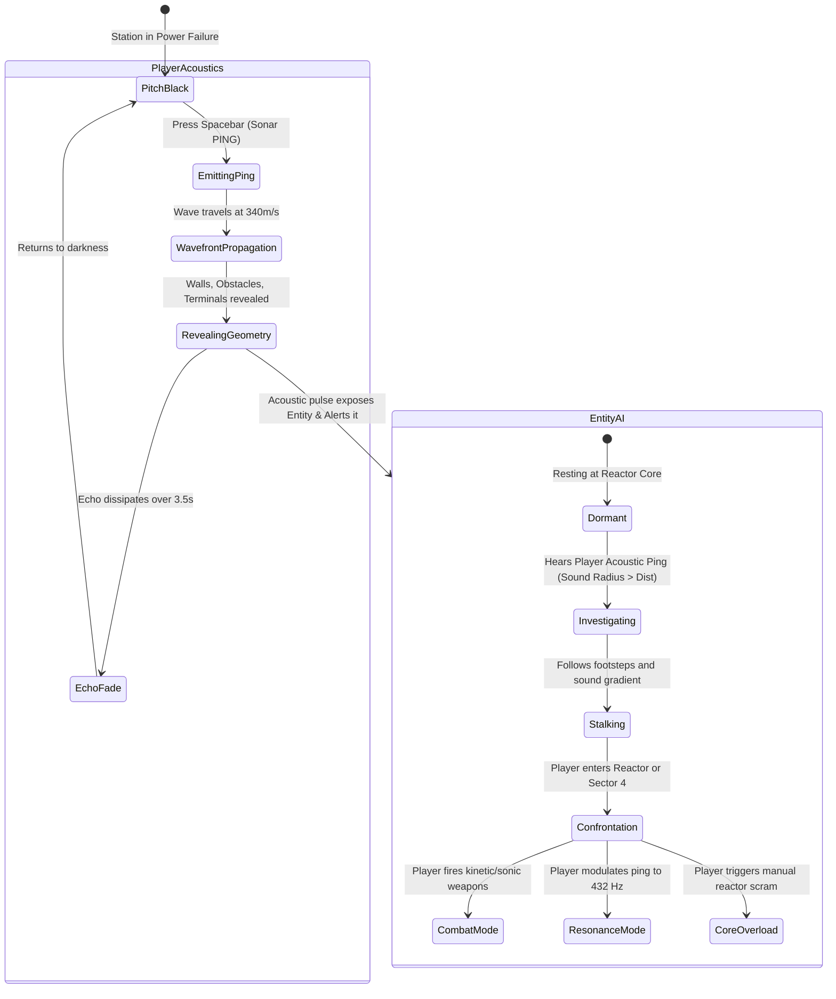

# 📊 ARUNA STATION: GAME FLOW & ARCHITECTURE STATE DIAGRAMS
**Visual System Design & Narrative Branching Engine**

---

## 1. COMPLETE HIGH-LEVEL GAME LIFECYCLE

```mermaid
flowchart TD
    Start([Game Start: March 15, 2047]) --> IntroCinematic[Phase 0: Houston Cinematic Briefing<br/>Audio Logs & Mission Directives]
    IntroCinematic --> StrategyPhase[Phase 1: Strategic Planning Console]
    
    subgraph Strategy_Phase [Phase 1: Decisions & Profile Generation]
        StrategyPhase --> Dec1{Decision 1:<br/>Entry Strategy}
        Dec1 -->|Option A| DockDirect[Main Dock: Direct Access<br/>+Electrical Surge, Unreliable Sonar]
        Dec1 -->|Option B| DockAirlock3[Airlock 3: Indirect Access<br/>+Stable Life Support, Entity Alert Early]
        
        DockDirect --> Dec2{Decision 2:<br/>Resource Allocation}
        DockAirlock3 --> Dec2
        
        Dec2 -->|Option A: 60pts| ResRescue[Rescue Focus: 6 Space Suits<br/>Save All Crew, Weak Sonar/Batteries]
        Dec2 -->|Option B: 50pts| ResHybrid[Hybrid: 4 Advanced + 2 Std Suits<br/>Balanced Ping Sonar + Sample Canister]
        Dec2 -->|Option C: 40pts| ResSurvival[Survival Focus: 2 Military Suits<br/>High-Spec Sonar, High Personal Survival]
        
        ResRescue --> Dec3{Decision 3:<br/>Objective Priority (Pick 2)}
        ResHybrid --> Dec3
        ResSurvival --> Dec3
        
        Dec3 -->|Rescue + Data| PriAB[A + B: Shepherd of Truth]
        Dec3 -->|Rescue + Base| PriAC[A + C: Sanctuary Salvation]
        Dec3 -->|Data + Base| PriBC[B + C: Cold Science Archeology]
        Dec3 -->|All Three: Hardcore| PriABC[A + B + C: Impossible Gambit]
    end

    Strategy_Phase --> CalculateMatrix[Calculate Science-Survival-Society Matrix<br/>Assign Mission Archetype Profile]
    CalculateMatrix --> LunarLanding[Lunar Descent & Landing Cutscene<br/>Telemetry Audio & Environmental Ping]
    
    LunarLanding --> SurvivalPhase[Phase 2: Survival Phase - Aruna Base Grid]
    
    subgraph Survival_Phase [Phase 2: In-Station Top-Down Sonar Exploration]
        SurvivalPhase --> Act1[Act 1: Entry & Acoustic Calibration]
        Act1 --> Act2[Act 2: Crew Triage & Module Navigation]
        Act2 --> Act3[Act 3: Deep Lab & The Meridian Discovery]
        Act3 --> Act4[Act 4: Reactor Chamber & Entity Encounter]
        Act4 --> Act5[Act 5: Final Evacuation Sprint]
    end
    
    Act5 --> EndingResolution{Ending Resolution Engine}
    EndingResolution --> Ending1[Ending 1: The Rescue]
    EndingResolution --> Ending2[Ending 2: The Discovery]
    EndingResolution --> Ending3[Ending 3: The Sacrifice]
    EndingResolution --> Ending4[Ending 4: Communication - First Contact]
    EndingResolution --> Ending5[Ending 5: The Burden]
    EndingResolution --> Ending6[Ending 6: Failure - Lunar Eclipse]
```

---

## 2. SCIENCE-SURVIVAL-SOCIETY (3S) MATRIX ENGINE

```mermaid
flowchart LR
    subgraph Inputs [Strategy Inputs]
        E[Entry Method]
        R[Resource Allocation]
        P[Mission Priorities]
    end

    subgraph Vector [3D State Vector]
        SCI[Science Metric: 0 - 100]
        SUR[Survival Metric: 0 - 100]
        SOC[Society/Rescue Metric: 0 - 100]
    end

    subgraph Archetypes [Generated Mission Profiles]
        P1["The Ideal (High Sci / High Sur / High Soc)"]
        P2["The Pragmatist (High Sci / High Sur / Low Soc)"]
        P3["The Idealist (High Sci / Low Sur / High Soc)"]
        P4["The Guardian (Low Sci / High Sur / High Soc)"]
        P5["The Survivor (Low Sci / High Sur / Low Soc)"]
        P6["The Scientist (High Sci / Low Sur / Low Soc)"]
    end

    Inputs --> Vector
    Vector --> Archetypes
```



---

## 3. CORE SURVIVAL ACOUSTIC RADAR STATE MACHINE



---

## 4. ENDING RESOLUTION MATRIX

```mermaid
flowchart TD
    ConfrontationResult{Climax Outcome}
    
    ConfrontationResult -->|Player communicates harmonically| CheckContact{Data Preserved?}
    CheckContact -->|Yes| E4[ENDING 4: First Contact<br/>Score: 950 | Achievement: First Contact]
    CheckContact -->|No| E1
    
    ConfrontationResult -->|Player triggers reactor scram| CheckHero{Player in Pod?}
    CheckHero -->|No Okafor sacrificed| E3[ENDING 3: The Sacrifice<br/>Score: 850 | Achievement: The Last Guardian]
    CheckHero -->|Yes escaped| CheckLives{Crew Rescued count}
    
    CheckLives -->|5-6 Crew Saved| E1[ENDING 1: The Rescue<br/>Score: 800 | Achievement: Shepherd]
    CheckLives -->|3-4 Crew Saved + Data| E2[ENDING 2: The Discovery<br/>Score: 900 | Achievement: Pioneer]
    CheckLives -->|1-2 Crew Saved| E5[ENDING 5: The Burden<br/>Score: 600 | Achievement: Haunted]
    
    ConfrontationResult -->|Player killed or O2 depleted| E6[ENDING 6: Failure<br/>Score: 200 | Achievement: Tragedy]
```
